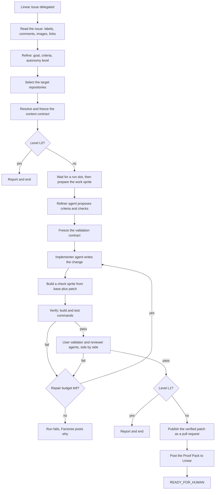

# Agents and runs

This page tells you which agents Factoree uses and what a run does. For the full design, read `docs/factoree-sdd.md`. For the parts of the system, read `docs/architecture.md`.

## The main rule

An agent writes code and reports. An agent never decides that a change is correct. Factoree runs the checks itself and decides from the results that it records.

## The agent roles

Each role is one agent session in a sandbox. Each session starts with no memory of other sessions, except where the table says so. The product settings choose the agent CLI and the model of each role.

| Role | When it runs | What it does | What it can change |
|---|---|---|---|
| Refiner | Once per run, after the work sprite is ready. | Reads the issue and the repository. Proposes the acceptance criteria and how to prove each one. It can propose more target repositories. | Nothing. Factoree checks each proposal and freezes only the ones that pass. |
| Implementer | Once per attempt. | Writes the change in the work sprite. A repair attempt gets the findings of the failed check. | The files of the target repositories in the work sprite. |
| User validator | Once per attempt, after verification passes. | Uses the running app in a check sprite, the way a user does, and checks each assertion of the validation contract. | Nothing. |
| Reviewer | Once per attempt, beside the user validator. | Reads the diff against the review rules. Reports the findings that block the change. | Nothing. |
| Triage | Once, at the start of a PR follow-up run that a failed PR reviewer check started. A reviewer session does it. | Keeps only the PR reviewer findings that name a real defect, a rule and evidence. Factoree replies on the pull request to each finding that it drops. | Nothing. |
| Setup agent | In a setup run, not in a run. | Writes `.factoree/config.yaml` for one repository. Factoree proves each part and proposes the result as a pull request. | Files in `.factoree/` only. |
| Retro agent | On a schedule, not in a run. | Reads the ended runs of a product and proposes improvements. A human decides which ones become Linear issues. | Nothing. |

The implementer works in the **work sprite**, which lives for the whole run. The checks run in a new **check sprite** for each attempt. Factoree builds the check sprite from the base commit plus the patch that it captured. The implementer never touches the sandbox where its change is checked.

## The kinds of run

| Kind | What starts it | How it ends when it succeeds |
|---|---|---|
| New run | A human delegates a Linear issue to Factoree. | A new pull request, or a report at L0 and L1. |
| Follow-up run | A human replies in the agent session of a failed run. It is a new run with the reply as a decision. | The same as a new run. |
| PR follow-up run | A failed PR reviewer check, a human "request changes" review, or a base conflict on an open Factoree pull request. | One new verified commit on that pull request. |
| Bring-current run | The base branch moved and the pull request must be up to date. | A merge commit of the base. No agent runs. Factoree replays the stored checks. |

## How a new run works

The steps in words:

1. Factoree reads the issue. If a role model cannot read the images of the issue, the run stops.
2. Refinement finds the goal and the criteria. If a product decision is open, Factoree asks one question in Linear and waits.
3. Factoree selects the repositories that the run changes. If no rule decides, Factoree asks.
4. Factoree resolves the context and freezes it as the context contract. If two sources of equal authority disagree, Factoree asks.
5. Factoree waits for a run slot. Then it prepares the work sprite.
6. The refiner proposes the criteria and the checks. Factoree takes each proposal that a rule or a cited source supports.
7. Factoree freezes the validation contract. After this point, no agent can change what success means.
8. The implementer writes the change.
9. Factoree captures the patch and builds a check sprite. Verification runs the build and test commands of the repository.
10. The user validator and the reviewer run at the same time, each in its own check sprite.
11. If a check fails and the repair budget is not spent, the implementer gets the findings and tries again. One budget covers the whole run.
12. When every check passes, Factoree publishes the exact patch that it checked. Then it posts the Proof Pack.

A stop from a human ends the run at once. The run also ends when it reaches its maximum duration.

## How the other kinds differ

- **PR follow-up run.** It keeps the repository of its pull request and starts from the pull request head. A failed PR reviewer check gets a triage first. If triage keeps no finding, the run changes nothing and ends. At the end, the run pushes one new commit and opens no new pull request.
- **Bring-current run.** Factoree merges the base into the branch on its own checkout. It checks the merge with the stored validation plan and no agent. It pushes the merge commit only when the checks pass. A conflict or a failed check starts a PR follow-up run.

## Where the code is

| Part | Location |
|---|---|
| Entry point. It reads the input and starts the story of its kind. | `src/workflows/agent-run.workflow.ts` |
| One file per kind of run, with its steps in order. | `src/workflows/agent-run/stories/` |
| The shared steps. A step takes its differences as inputs and never asks which kind of run it serves (`checks/run-kind.sh`). | `src/workflows/agent-run/stages/` |
| The run state, the end of a run, questions and waits. | `src/workflows/agent-run/run.ts` |
| The agent session calls, with the retries after a hang or an unreachable provider. | `src/workflows/agent-run/sessions.ts` |
| The work that touches the outside world: sandboxes, Linear, GitHub. | `src/activities/` |

The workflow code must stay deterministic, because Temporal replays it after a worker restart. `tests/workflow/replay.workflow.test.ts` replays recorded runs, and it fails when a change alters the order of the steps of an open run.
